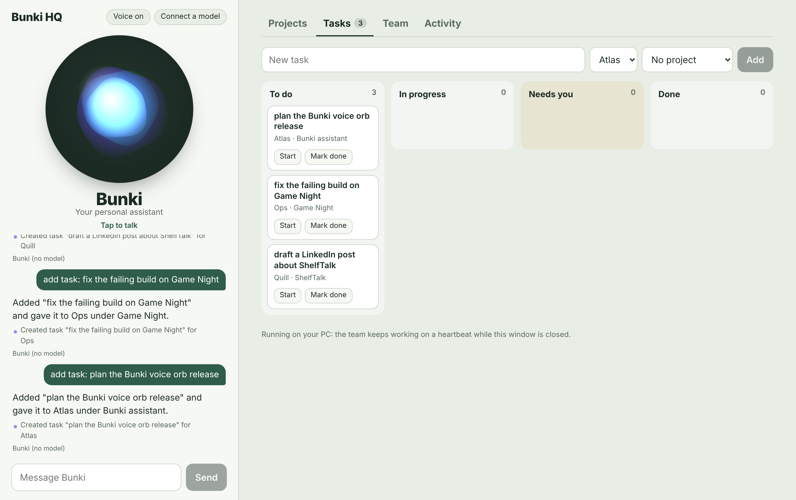
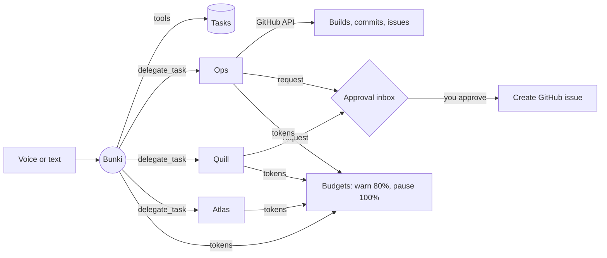
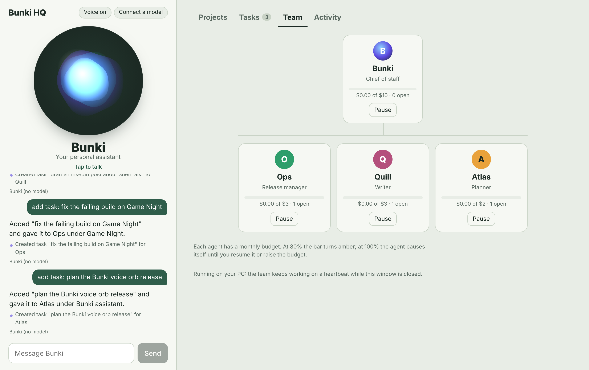

# Bunki HQ

**Bunki**, my personal assistant, is a talking orb that runs a small company of AI agents across my projects. I ask by voice or text; Bunki checks builds on GitHub, turns requests into tasks, hands them to the right specialist and reports back. Anything that changes something outside the app waits for my approval.



Inspired by [Paperclip](https://github.com/paperclipai/paperclip)'s idea of running agents as a company, built from scratch with its own design and a much smaller scope: one person, a handful of projects, and a voice.

## What it does

- **Talk to Bunki.** Tap the orb and speak (browser speech recognition), or type. Bunki answers out loud; the orb listens, thinks and speaks in different colours and moves with your voice.
- **Projects.** Each project card shows its live build status, last commit and open issues from the GitHub API, plus its goal and open tasks.
- **A team with an org chart.** Bunki (chief of staff) delegates to Ops (release manager), Quill (writer) and Atlas (planner). Each agent only gets the tools its role needs.
- **Tasks with atomic checkout.** One agent works on a task at a time; tasks move through To do, In progress, Needs you and Done.
- **Approvals.** GitHub issues and post drafts go to a "Waiting for you" inbox. Nothing is created until you approve, and Bunki never posts for you.
- **Budgets.** Every agent has a monthly dollar budget from token usage. The bar turns amber at 80%, and the agent pauses itself at 100%.
- **Activity log** of every action, by whom, and what it cost.
- **Works without a model.** With no API key, Bunki can still give a build status from GitHub, add and route tasks, and read out approvals. Connect Claude or Azure AI Foundry to run the team.

## Three ways to run it

| | Where your data lives | Team works while closed? |
|---|---|---|
| **In the browser** ([GitHub Pages](https://bunki-dev.github.io/bunki-hq/)) | This browser only | No |
| **On your PC** (`npm run pc`) | `~/.bunki-hq/hq.db` (SQLite) | Yes, on a heartbeat |
| **As an app** | Either of the above: in Chrome or Edge choose *Install app*; on iPhone, *Add to Home Screen* | |

```bash
npm install
npm run pc        # builds the UI, starts http://localhost:4317 (this machine only)
```

On the PC the server checks builds and works through assigned tasks every 15 minutes (`HEARTBEAT_MINUTES`). Keys can be entered in Settings (saved to `~/.bunki-hq/settings.json`) or set as `ANTHROPIC_API_KEY`, `AZURE_OPENAI_*` and `GITHUB_TOKEN`. Requires Node 22.18 or later; there are no runtime dependencies beyond React.

## How it's built



- `src/core/hq.ts`: the engine. Agent loop with tool calling, per-role tool allowlists, delegation (one level deep), atomic task checkout, approvals that execute only on approval, budget tracking and auto-pause, activity log, heartbeat, and the no-model fallback.
- `src/core/llm.ts`: small adapters for the Anthropic Messages API and Azure OpenAI over `fetch`, with prompt caching on Anthropic.
- `src/core/github.ts`: build status, last commit and issue counts; issue creation (approval only).
- `src/server/server.ts`: the PC server on Node's built-in `node:http` and `node:sqlite`. It binds to 127.0.0.1, refuses requests from other origins, and exposes a fixed list of engine methods.
- `src/web/`: React UI, the canvas orb, Web Speech API voice in and out, and an installable PWA.

The same TypeScript engine runs in the browser and on the server.

## Tests

`npm test` runs the engine tests with Node's built-in test runner and a scripted model:

- Bunki creates a task and delegates it, and the specialist finishes it with only its own tools.
- Agents can't call tools outside their role.
- GitHub issues are only created after approval; rejecting changes nothing.
- An agent that hits its budget pauses and stops mid-run.
- Task checkout is exclusive.
- Without a model, Bunki still reports build status and routes new tasks.
- When GitHub can't be reached, Bunki says so instead of calling the builds green.

CI also starts the PC server, sends it a message, and checks that requests from other websites are refused.

## Privacy

API keys stay on your device (browser storage, or the settings file on your PC) and go only to the provider you choose. Voice recognition uses your browser's built-in recogniser, which may send audio to Google (Chrome) or Apple (Safari).


